# Suivi — reconstruction du guide utilisateur (branche `docs/guide-utilisateur-complet`)

Mis à jour et commité à la fin de chaque étape. Les miniatures (120 px) renvoient aux captures réelles de `docs/guide-utilisateur/captures/`.

| Étape | Statut | Tests joués (pass/fail) | Pages écrites | Captures | Dernier commit |
|---|---|---|---|---|---|
| A. Environnement et base | fait | — | 0 | — | f760d21 |
| B. Helper de capture | fait | 1 pass (capture.mask) ; check 0 erreur | 0 | — | a9e56f7 |
| C. Rejeu complet (blocs A à J) | fait (parcours non joués listés) | sim 05/06/10/11/12/20/31/32/40/41/42/43 tous pass ; 30-rpr 7 fixme ; e2e menu 12, a11y 10, conformité 10, téléphone 7 pass | 0 | 64 dans captures/ | 514e19e |
| D. Matrices et dossier de reprise | fait | — | 0 | — | 3278348 |
| E. Rédaction du guide | fait | guide.test.mjs 7/7 | 24 (17 nouvelles, 4 mises à jour, index) | 64 | 3d08462 |
| F. Vérifications | fait | unitaires 54/54, check/build OK, menu 12/12, a11y 10/10, onglet 2/2 ; SQL 14 échecs (données de scénario) ; verify-payroll écart attendu ; Mintlify NON TESTÉ (CLI `mint` absent) | 0 | onglet : 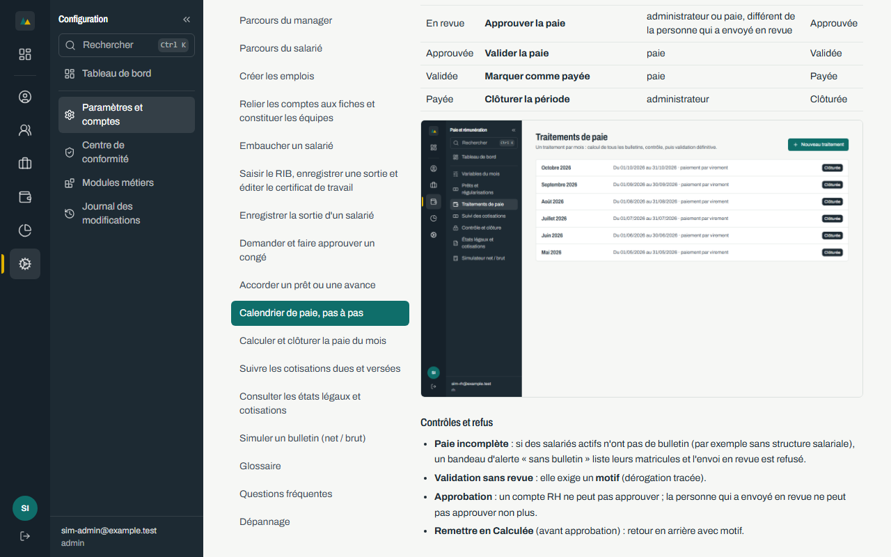 | voir `git log` |
| G. Clôture | fait | — | 0 | — | voir `git log` |

Miniatures : 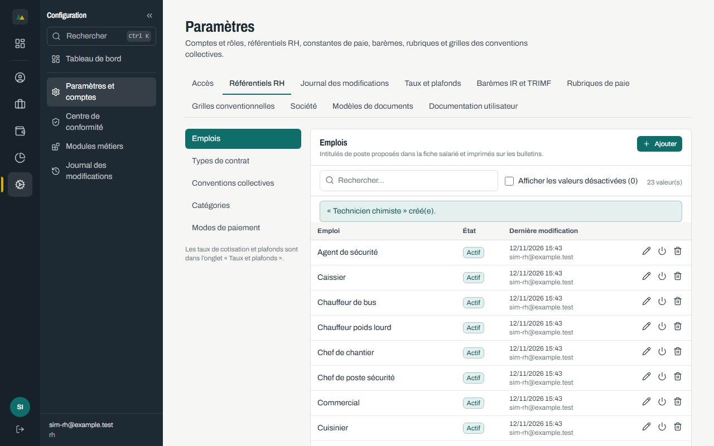 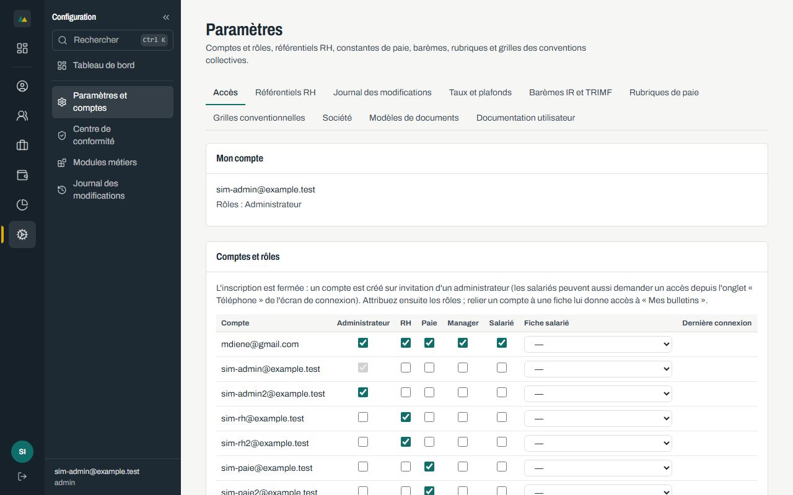 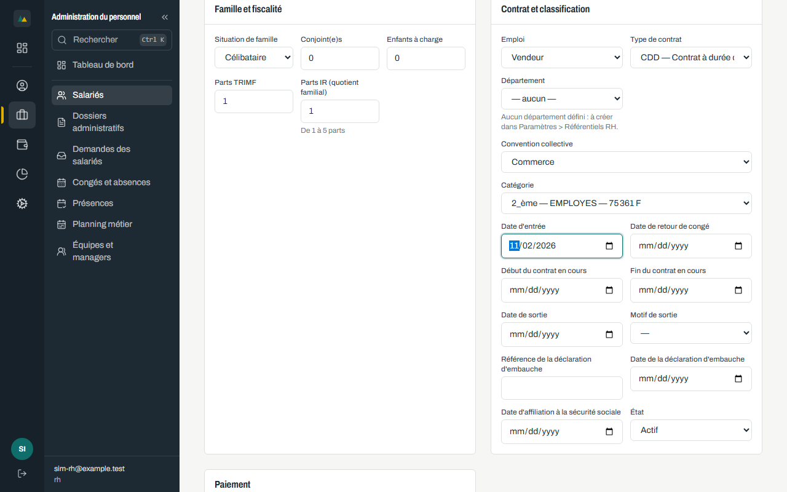 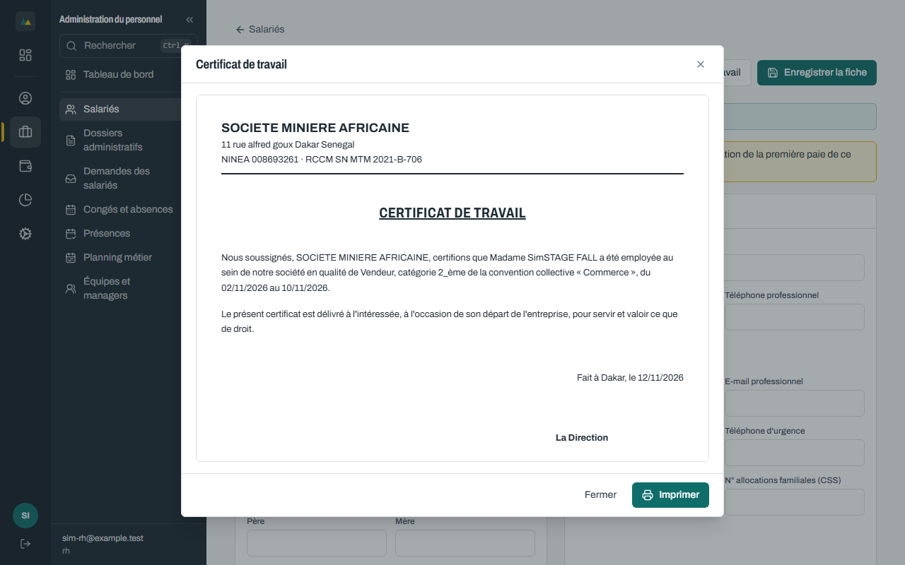 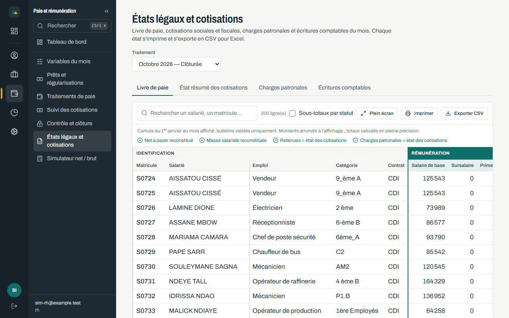 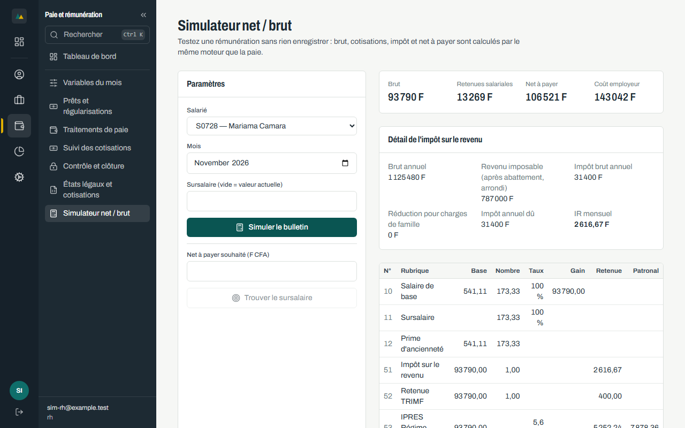 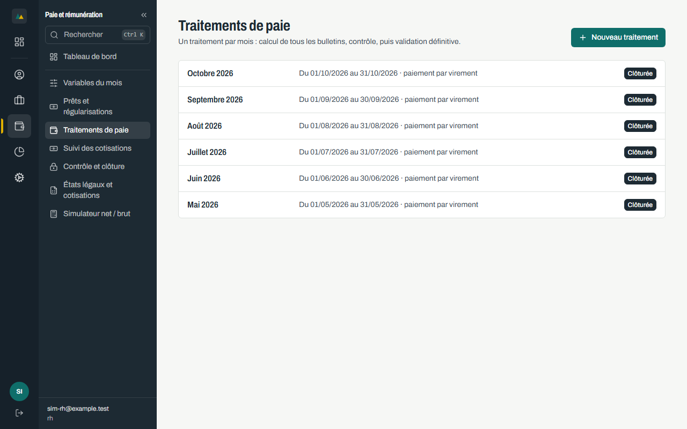 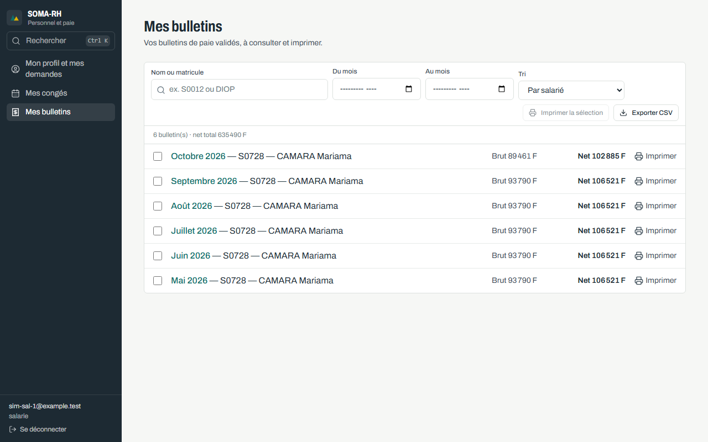

## Étape A — notes
- Branche `docs/guide-utilisateur-complet` créée depuis `fix/rpr-09-prorata` ; un premier commit isole l'onglet « Documentation utilisateur » (travail préexistant non commité).
- Sauvegarde : `backups/soma-rh-20261112-153339.dump` (base de 200 salariés, avant remise à zéro).
- Base remise à zéro (décision du propriétaire) : 0 salarié, 1 compte (mdiene) ; 20 comptes `sim-*` recréés.
- **Outillage corrigé** : `tests/fixtures/sim/reset-zero.sql` refusait de s'exécuter (tables `employee_loan_caps`, `phone_access_accounts`, `phone_access_requests`, `phone_access_tokens` absentes de sa liste). Ajoutées ; aucune modification de l'application.
- **Constat** : `scripts/check-migrations.sh` sort en erreur (préfixes dupliqués hors liste blanche : 20261204090000, 20261206090000, 20261207090000, 20261208090000). Antérieur à cette campagne, non corrigé ici.
- Application sur http://localhost:5173 : répond 200 ; conteneurs api, postgres, postgrest actifs.

## Étape C — journal
### Bloc A · Emplois (palier 11)
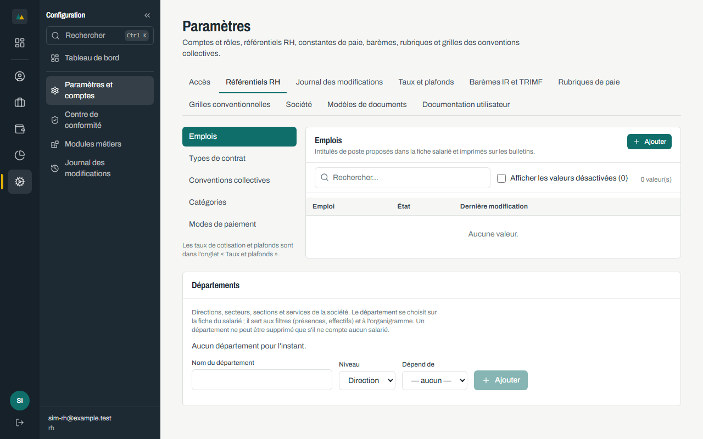 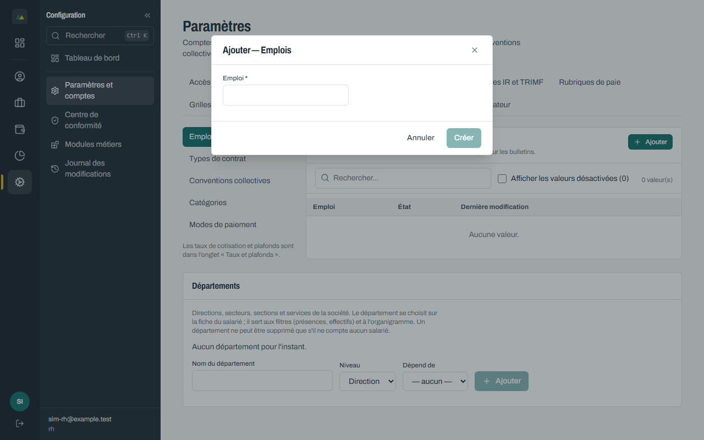 

Sur base remise à zéro, le référentiel « Emplois » est vide : 23 emplois créés par Paramètres › Référentiels RH (`05-demarrer.sim.spec.ts`). VERT.

### Paliers 5 à 9 (100 → 200 salariés) — VERT (5/5)
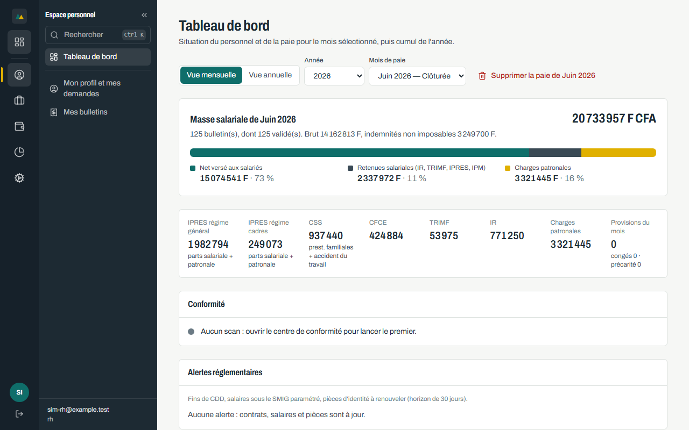 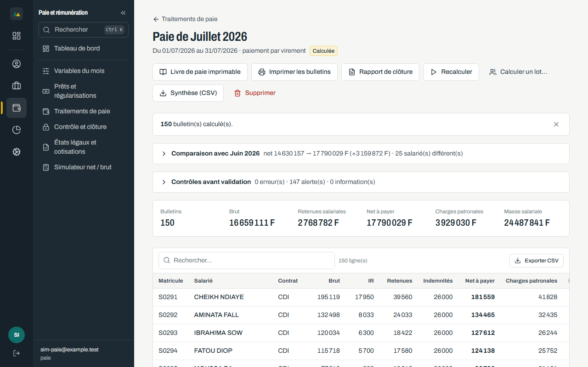 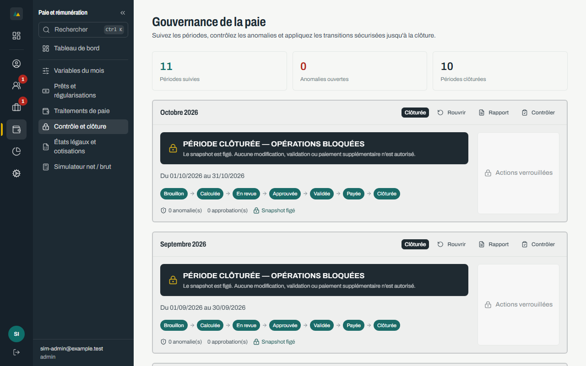

- Base : 200 salariés, 200 affectations de structure.
- **ORANGE à confirmer (intermittent)** : sur la page d'un salarié neuf, la section « Structure salariale » n'apparaît parfois pas dans les 8 s (3 occurrences sur ~200 embauches), ou la page reste blanche. Cause non établie (lenteur du serveur de développement ou chargement paresseux). Délai du test porté à 20 s ; aucune correction de l'application.
- Problèmes de test corrigés (sans effet sur l'application) : sélecteur « Enregistrer » ambigu avec « Enregistrer la fiche » ; emplois à recréer après remise à zéro.

### Parcours existants rejoués (base remise à zéro) — aucun ROUGE, aucune régression par rapport au palier 10
| Fichier | Résultat | Remarque |
|---|---|---|
| 06-comptes (nouveau) | 2/2 VERT | comptes reliés aux fiches, équipe de `sim-mgr-1` (captures acces-*, equipes-*) |
| 11-octobre | 4/4 VERT | sortie D-56, congé, prêt (plafond 1/3 refusé : « Retenue mensuelle trop élevée… »), calcul et clôture d'octobre |
| 12-reouverture | VERT | réouverture motivée, recalcul (1 ligne RET_PRORATA), reclôture |
| 20-roles | 8/8 VERT | pages autorisées par rôle, refus pour manager et salarié, isolation des bulletins |
| 30-rpr | 7 fixme | RPR-03, 05, 07, 08, 11, 13, 15 : couvertes par SQL/API/unitaires, pas par Playwright (NON REJOUÉ) |
| 31-rpr-mutating | 6/6 VERT | RPR-01/12, 02, 04, 06, 10, 14 |
| 32-telephone | 6/6 VERT | demande, autorisation admin, usage unique, 5 dates fausses, réinitialisation/révocation, refus |
| e2e menu / a11y / conformité / téléphone | 12 / 10 / 10 / 7 VERT | comptes QA régénérés depuis les comptes SIM |

**Constat ORANGE du palier 10 (étape manager des congés) : TRANCHÉ.** Rejoué : `sim-mgr-1` approuve l'étape 1 (« Mon équipe »), `sim-rh` l'étape 2 ; état final « Approuvée ». Plus d'ORANGE.

**Outillage** : `qa-create-users.ps1` échoue (403, l'inscription publique est fermée) ; `tests/.env.qa` (hors Git) régénéré depuis `tests/.env.qa-sim`. Matricules des tests décalés (+433) après la remise à zéro.

## Étapes D à G — résumé
- Matrice : 136 lignes (124 VERT, 0 ORANGE, 0 ROUGE, 1 BLOQUÉ paiements par lot, 11 NON JOUÉ). Fiches RPR-16 (ORANGE intermittent) et RPR-17 (corrigée, images 403 en développement).
- Correction faite avec l'accord du propriétaire : `web/vite.config.ts` (`server.fs.allow`). Aucune autre correction de l'application.
- Mintlify : NON TESTÉ, la commande `mint` n'est pas installée.
- Risque : aucune des corrections RPR ouvertes n'a été faite pendant la campagne.

## Après la clôture (12/11/2026)
| Étape | Résultat | Commit |
|---|---|---|
| Aide pour tous les rôles | entrée de menu `/aide`, tests menu 12/12, accessibilité 11/11, guide 7/7 | 6395a1a |
| Publication | branche fusionnée dans `main`, poussée | f1e4127 |
| Déploiement Vercel | production READY, `.vercelignore` étendu au guide | — |
| Campagne 2 | 13 UC verts supplémentaires (congés spéciaux, présences et HS, planning, variables, demande de profil, apprentissage, ajout à la simulation) ; RPR-18 ORANGE | 843cbba |
| Guide | 28 pages, 7 contrôles d'intégrité verts, onglet et Aide vérifiés en e2e | 843cbba |

Reste à jouer : voir `docs/passation/PASSATION_SOMA-RH_2026-11-12.md` (troisième passe).
